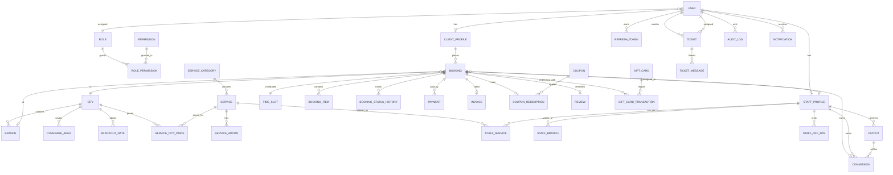

# ERD (core)

## Notes

- **Partial unique index** on `bookings (specialistId, date, timeSlotId)` where
  status ∉ (`CANCELLED`, `NO_SHOW`) and `deletedAt IS NULL`.
- Money fields: `Decimal(10,2)`.
- `commissionRateSnapshot` and `commissionAmount` are frozen on the booking when
  it reaches `COMPLETED`.
- `booking_items` snapshot the title and unit price so catalog changes never
  rewrite history.
- `settings` is a key/value JSON store (`booking.settings`, `cms.content`,
  `finance.tax`).
